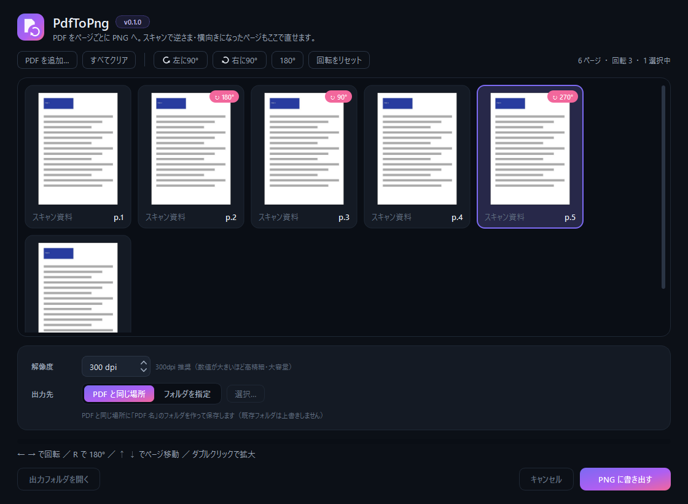
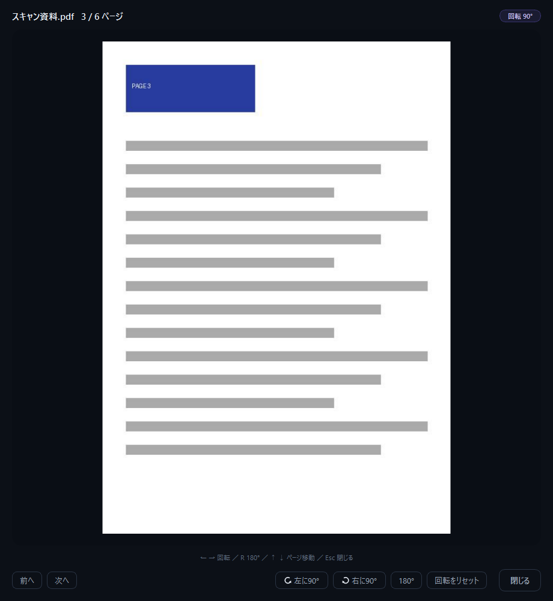

# PdfToPng

PDF をページごとに PNG 画像へ分解する Windows 用アプリです。
スキャンした PDF で **上下逆さま・横向きになってしまったページを、書き出す前にサムネイルで確認して直せます。**



## ダウンロード

[**最新版をダウンロード（Releases）**](../../releases/latest)

| ファイル | 内容 |
| --- | --- |
| `PdfToPng-Setup-<version>.exe` | **インストーラー（おすすめ）**。管理者権限なしでインストールできます |
| `PdfToPng-<version>-portable.zip` | ポータブル版。展開して `PdfToPng.exe` を起動するだけ（インストール不要） |

- 対応 OS：Windows 10 / 11（64bit）
- Python などの追加インストールは不要です

> **初回起動時の警告について**
> 本アプリはコード署名をしていないため、「Windows によって PC が保護されました」と表示されることがあります。
> その場合は［詳細情報］→［実行］で起動できます。

## 使い方

1. PDF をウィンドウにドラッグ＆ドロップ（またはクリックしてファイルを選択）
2. サムネイルで向きを確認し、向きがおかしいページを選んで回転
3. ［PNG に書き出す］をクリック

PDF と同じ場所に「PDF 名」のフォルダができ、`スキャン資料_001.png`, `スキャン資料_002.png` … の連番で保存されます。

## 主な機能

- **複数 PDF をまとめて読み込み**（フォルダごとのドロップも可）
- **ページの回転**：左 90° / 右 90° / 180° / リセット。複数ページを選んで一括回転も可能
- **拡大プレビュー**：ダブルクリックで大きく表示。その画面でも回転・ページ送りができます
- **解像度（DPI）を指定**して書き出し（既定 300dpi）
- 保存先は「PDF と同じ場所」または任意のフォルダ
- **上書きしない**：同名フォルダがあれば `PDF名_1` のように別名で作成。**元の PDF は一切変更しません**
- パスワード付き・破損した PDF はエラーを表示して、ほかの PDF の処理を続けます



### キーボード操作

| キー | 動作 |
| --- | --- |
| ← / → | 選択ページを左 / 右に 90° 回転 |
| R | 選択ページを 180° 回転 |
| ↑ / ↓ | 前 / 次のページへ移動 |
| Enter / Space / ダブルクリック | 拡大プレビュー |
| Ctrl+A | すべて選択 |

## アンインストール

- インストーラー版：Windows の「設定 → アプリ」から PdfToPng をアンインストール
- ポータブル版：フォルダごと削除

---

## 開発者向け

### 開発環境（PC に Python をインストールしない）

`tools\setup.ps1` が、プロジェクトフォルダ内の `.tools\` に uv と Python 本体を、
`.venv\` に依存パッケージを用意します。PATH やレジストリは変更しません。
不要になったら `.tools\` と `.venv\` を削除すれば元通りです。

```powershell
powershell -ExecutionPolicy Bypass -File tools\setup.ps1   # 初回のみ（要インターネット）
.\.venv\Scripts\python.exe run.py                          # 起動
.\.venv\Scripts\python.exe -m pytest                       # テスト
```

### ビルド（配布物の作成）

```powershell
powershell -ExecutionPolicy Bypass -File build\build.ps1              # ポータブル版 zip
powershell -ExecutionPolicy Bypass -File build\build.ps1 -Installer   # ＋インストーラー
```

環境準備 → テスト → アイコン生成 → PyInstaller 凍結 → `dist\` に zip（`-Installer` 時はインストーラーも）作成まで行います。
インストーラー作成に使う Inno Setup 6 も、`tools\setup-inno.ps1` がフォルダ内の `.tools\innosetup` に
ポータブル展開して使います（PC へのインストール・レジストリ登録なし）。

### リリース手順

1. `src\pdftopng\__init__.py` の `__version__` と `pyproject.toml` の `version` を更新
2. `build\build.ps1 -Installer` で `dist\` に配布物を作成
3. `git tag vX.Y.Z && git push origin vX.Y.Z`
4. GitHub の Releases でそのタグから Release を作成し、`dist\` のインストーラーと zip を添付

### 構成

```text
src/pdftopng/
├── core/        # GUI 非依存の処理（PDF 読み込み・回転・ファイル名・書き出し）
├── ui/          # 画面（テーマ・ページ一覧・プレビュー・メイン画面）
├── worker.py    # サムネイル生成・書き出しを別スレッドで実行
└── config.py    # 既定値・設定の保存
```

技術スタック：Python 3.12 / PySide6 / Pillow / pypdfium2 / PyInstaller / Inno Setup

## ライセンス

- 本体: MIT
- 依存: PySide6 (LGPL v3) / Pillow (HPND) / pypdfium2 (Apache-2.0 / BSD-3-Clause, PDFium: BSD-3-Clause)
